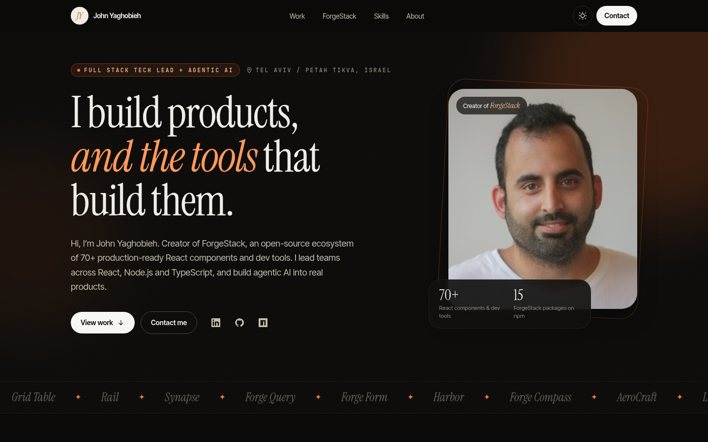

<div align="center">


# John Yaghobieh

**Full Stack Tech Lead + Agentic AI · Tel Aviv / Petah Tikva, Israel**

Creator of **ForgeStack**, an open-source ecosystem of 70+ production-ready React components and dev tools.

[](https://yaghobieh.github.io/yaghobieh/)

[](https://yaghobieh.github.io/yaghobieh/)

[](https://github.com/yaghobieh)
[](https://www.npmjs.com/~yaghobieh)
[](https://www.linkedin.com/in/john-yaghobieh-4baa93107/)

</div>

---

### 🌐 Personal site

**[https://yaghobieh.github.io/yaghobieh/](https://yaghobieh.github.io/yaghobieh/)**

Work · ForgeStack · Skills · About · Contact. Built with React, TypeScript, Vite and Tailwind, with light and dark themes, deployed from this repo by GitHub Actions.

```bash
npm install
npm run dev      # local dev server
npm run build    # type-check + production build (base path /yaghobieh/)
npm run preview  # serve the production build
```

<details>
<summary><strong>First-time Pages setup (one click)</strong></summary>

If the link above shows “Site not found”:

1. Open [github.com/yaghobieh/yaghobieh/settings/pages](https://github.com/yaghobieh/yaghobieh/settings/pages)
2. **Build and deployment → Source:** select **GitHub Actions**
3. Re-run the latest [Deploy workflow](https://github.com/yaghobieh/yaghobieh/actions/workflows/deploy.yml)

</details>
